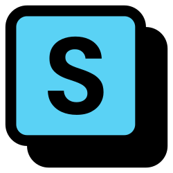

### Solstack: web tools for Solana tokens

Create, launch, airdrop, multisend, lock and inspect Solana tokens at **[solstack.xyz](https://solstack.xyz)**. No account, no install: connect any Solana wallet, and your keys stay in your wallet.

 

**Most used:** [Create an SPL token](https://solstack.xyz/tools/create-solana-spl-token) · [Token-2022 creator](https://solstack.xyz/tools/create-solana-token-2022) · [Multisender](https://solstack.xyz/tools/solana-multisender) · [Airdrop to holders](https://solstack.xyz/tools/solana-token-airdrop) · [Token Inspector](https://solstack.xyz/tools/solana-token-inspector) · [Holder Snapshot](https://solstack.xyz/tools/solana-token-holder-snapshot) · [Rent Reclaim](https://solstack.xyz/tools/reclaim-solana-rent) · [Wallet Cleaner](https://solstack.xyz/tools/solana-wallet-cleaner) · [pump.fun launcher](https://solstack.xyz/tools/launch-token-on-pumpfun) · [all 34 tools](https://solstack.xyz/tools)

**Open-source scripts:** [solana-multisender](https://github.com/solstackxyz/solana-multisender) · [solana-rent-reclaim](https://github.com/solstackxyz/solana-rent-reclaim) · [solana-holder-snapshot](https://github.com/solstackxyz/solana-holder-snapshot)

**Learn:** [Docs](https://solstack.xyz/docs/overview) · [Academy](https://solstack.xyz/academy) · [Blog](https://solstack.xyz/blog)

**Find us:** [X](https://x.com/solstack_xyz) · [YouTube](https://www.youtube.com/@Solstack) · [Telegram](https://t.me/solstack_xyz) · [Medium](https://solstackxyz.medium.com) · [@SolstackScanBot](https://t.me/SolstackScanBot)
